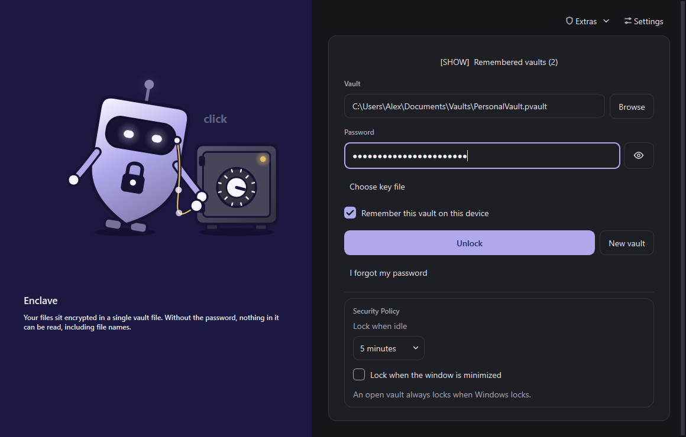
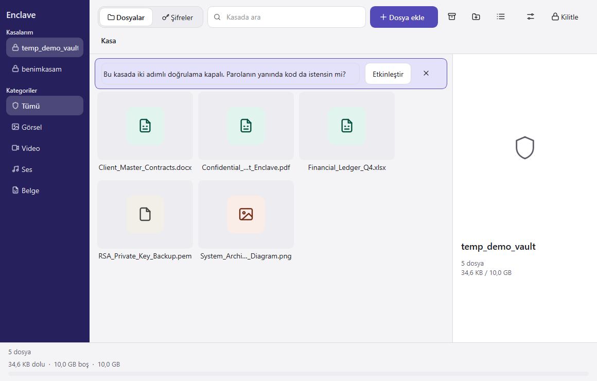
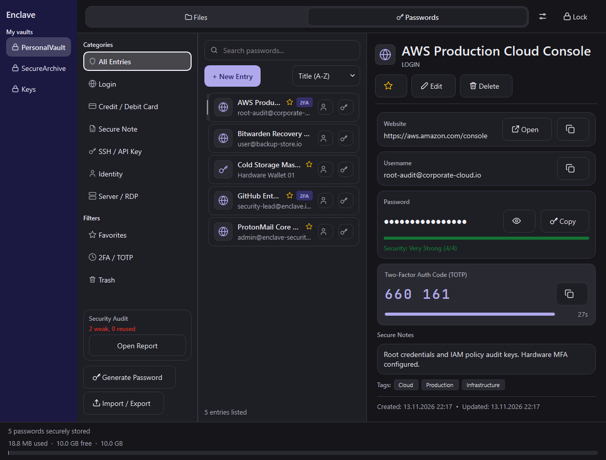
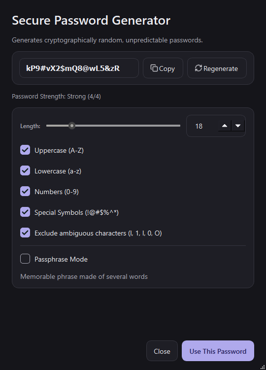
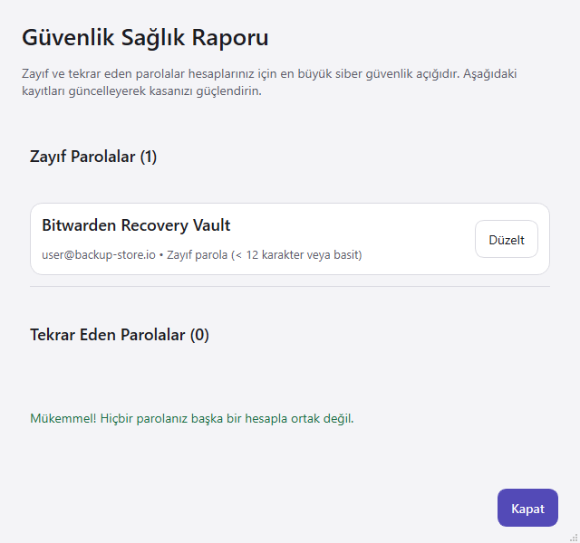
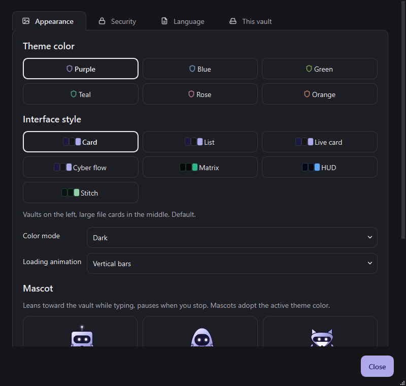

# Enclave

[](https://github.com/furkanndev/Enclave/releases/latest)
[](LICENSE)
[](https://www.python.org/)
[](#security-architecture)
[](#cross-platform-architecture)
[](#zero-forensic-traces--memory-hygiene)

> **Enclave** is a zero-knowledge encrypted vault, steganographic media carrier, and integrated password manager. It protects sensitive files, credentials, and digital assets on Windows, macOS, and Linux while minimizing forensic traces on disk.

---

## Table of Contents
- [Interface Showcase](#interface-showcase)
- [Key Capabilities](#key-capabilities)
- [Security Architecture](#security-architecture)
  - [1. Standalone Cryptographic Container (.pvault)](#1-standalone-cryptographic-container-pvault)
  - [2. Steganography & Plausible Deniability](#2-steganography--plausible-deniability)
  - [3. Integrated Password & Secret Manager](#3-integrated-password--secret-manager)
  - [4. Zero Forensic Traces & Memory Hygiene](#4-zero-forensic-traces--memory-hygiene)
  - [5. Windows Virtual Disk (VHD/VHDX) & BitLocker](#5-windows-virtual-disk-vhdvhdx--bitlocker)
- [Download](#download)
- [Installation & Quick Start](#installation--quick-start)
- [Building Standalone Executables](#building-standalone-executables)
- [Command Line Interface (CLI)](#command-line-interface-cli)
- [Keyboard Shortcuts](#keyboard-shortcuts)
- [Threat Model & Security Guarantees](#threat-model--security-guarantees)
- [License](#license)

---

## Interface Showcase

### 1. Zero-Knowledge Unlock & Guardian Screen
Secure unlock portal supporting master passwords, hardware key files, and two-factor authentication (TOTP/Windows Hello).



---

### 2. Encrypted Workspace & File Manager
Fluid drag-and-drop workspace with chunked streaming encryption, in-memory previews, category filters, and real-time storage metrics.



---

### 3. Integrated 3-Column Password Manager
Zero-knowledge credential vault featuring isolated sub-key derivation, tag indexing, search filtering, and live RFC 6238 TOTP authenticators.



---

### 4. Cryptographic Password & Passphrase Generator
High-entropy cryptographic generator supporting customizable charsets, Diceware passphrases, unambiguous presets, and visual strength ratings.



---

### 5. Security Health & Vulnerability Audit
Instant visual audit that scans for compromised passwords, reused credentials, weak passphrases, and unconfigured two-factor authenticators.



---

### 6. Design System & Security Preferences
Customizable design tokens with Apple Minimal and Fluent themes, automatic idle timeout locks, and internationalization (English & Turkish).



---

## Key Capabilities

- **Cross-Platform Compatibility:** Runs natively on Windows 10/11, macOS (Apple Silicon & Intel), and Linux (Ubuntu, Debian, Fedora, Arch).
- **Modern Cryptography:** Authenticated **AES-256-GCM** encryption with state-of-the-art **Argon2id** key derivation (256 MiB memory, 3 iterations) and PBKDF2 backwards-compatibility.
- **Polyglot Carrier Steganography:** Disguises an entire encrypted container inside ordinary media files (MP4, MKV, FLAC, MP3, PNG, JPG, ISO, ZIP). Files play and render completely normally in VLC or Windows Media Player without exposing any unencrypted signature.
- **Decoy Vault & Plausible Deniability:** Create a dual-compartment vault with two separate passwords. Unlocking with the decoy password shows benign files, concealing the existence of the primary vault.
- **Integrated Password Manager:** Securely store logins, payment cards, API keys, secure notes, and identities with real-time 30-second TOTP tokens and automated clipboard scrubbing.
- **Minimal Forensic Footprint:** All thumbnails, decrypted previews, and icon caches are rendered strictly in RAM (`RAM-Only`). Temporary files generated for viewing are sanitized with DoD 5220.22-M zero-byte overwriting and forced `os.fsync`.
- **Global Emergency Panic Switch (`Ctrl + Alt + L`):** Instantly closes open explorer windows, unmounts drives, purges temporary memory buffers, and minimizes the application to the tray immediately.
- **Auto-Lock on Workstation Lock (`Win + L`):** Monitors Windows session change events and automatically locks the vault and dismounts virtual drives whenever the user locks the OS or an idle timer expires.

---

## Security Architecture

```
+-----------------------------------------------------------------------------------+
|                                 USER INPUT / GUI                                  |
|         (Master Password + Optional Hardware Key File + TOTP / Biometrics)        |
+-----------------------------------------------------------------------------------+
                                          |
                                          v
+-----------------------------------------------------------------------------------+
|                        KEY DERIVATION FUNCTION (KDF)                              |
|          Argon2id (Memory: 256 MiB, Time: 3 passes, Parallelism: 4 threads)       |
+-----------------------------------------------------------------------------------+
                                          |
                                          v
+-----------------------------------------------------------------------------------+
|                              MASTER ENCRYPTION KEY                                |
|                           256-bit Cryptographic Key                               |
+-----------------------------------------------------------------------------------+
               |                                                   |
               v                                                   v
+-----------------------------+                     +-----------------------------+
|   CONTAINER ENGINE (AES-GCM)|                     |   SUB-KEY ENGINE (HKDF-SHA) |
| - 4 MiB Streaming Blocks    |                     | - Isolated Sub-Key          |
| - 96-bit Unique Nonce / Blk |                     | - AES-256-GCM + Zlib        |
| - Authenticated Integrity   |                     | - Zero-Knowledge Passwords  |
+-----------------------------+                     +-----------------------------+
```

### 1. Standalone Cryptographic Container (`.pvault`)
- Every `.pvault` file is completely standalone and self-contained; no central database or cloud service is required.
- Files are encrypted in **4 MiB chunks** using **AES-256-GCM**, allowing gigabyte-sized files to be securely read and written without consuming excessive memory.
- Writes are transactionally committed with atomic headers to ensure files remain uncorrupted even during sudden power outages.

### 2. Steganography & Plausible Deniability
- **Carrier Wrapping:** Wrap any `.pvault` container into an existing media file without re-encoding the media stream.
- **No Disk Signatures:** The carrier vault uses a headerless anchor structure with key-derived offsets, preventing automated forensic scanners from detecting encrypted payloads.
- **Dynamic Carrier Stripping:** Seamlessly extract the pure `.pvault` container from a carrier file at any time.

### 3. Integrated Password & Secret Manager
- **HKDF Sub-Key Isolation:** Secrets are not encrypted with the raw master key. An independent 256-bit sub-key is derived via HKDF-SHA256, creating a cryptographic firewall between files and credentials.
- **Live RFC 6238 TOTP Engine:** Eliminates the need for a separate phone authenticator app; generates dynamic 6-digit codes with millisecond precision countdown bars.
- **Zero Clipboard Footprint:** Clipboard copies set Windows `ExcludeClipboardContentFromMonitorProcessing` flags to prevent third-party clipboard managers and cloud synchronizers from caching sensitive passwords. Passwords automatically clear from the clipboard after 30 seconds.

### 4. Zero Forensic Traces & Memory Hygiene
- **RAM-Only Caches:** Icons, image thumbnails, and text previews never touch persistent storage in unencrypted form.
- **DoD 5220.22-M Secure Wipe:** When viewing a document externally, temporary files are destroyed upon vault lock by overwriting 100% of the byte stream with zeroes and invoking `os.fsync` before deletion.
- **Startup & Shutdown Sweeper:** Enclave sweeps and securely wipes any orphaned files from prior system crashes whenever the application starts or exits.

### 5. Windows Virtual Disk (VHD/VHDX) & BitLocker
- On Windows systems, Enclave optionally creates and attaches virtual hard disks formatted with native BitLocker encryption.
- Attached virtual drives mount seamlessly with dedicated drive letters (e.g., `Z:`) and automatically dismount when the session is locked or panic hotkeys are pressed.

---

## Download

Prebuilt packages and release notes are published on the [Releases page](https://github.com/furkanndev/Enclave/releases/latest). The latest version is **2.0.1**. See the [changelog](CHANGELOG.md) for details.

---

## Installation & Quick Start

### Prerequisites
- Python 3.10, 3.11, 3.12, or 3.13.
- Operating System: Windows 10/11, macOS 12+, or any modern Linux distribution with X11/Wayland.

### Installation

1. **Clone the repository:**
   ```bash
   git clone https://github.com/furkanndev/Enclave.git
   cd Enclave
   ```

2. **Create and activate a virtual environment (recommended):**
   ```bash
   # Windows
   python -m venv venv
   .\venv\Scripts\activate

   # macOS / Linux
   python3 -m venv venv
   source venv/bin/activate
   ```

3. **Install dependencies:**
   ```bash
   pip install -r requirements.txt
   ```

4. **Launch Enclave:**
   ```bash
   python main.py
   ```

---

## Building Standalone Executables

Enclave includes an automated PyInstaller builder that packages the entire application into a single executable without requiring Python on the target machine:

```bash
python build_exe.py
```

- **Windows:** Compiles a portable standalone binary at `dist/Enclave.exe`.
- **macOS:** Produces a native application bundle at `dist/Enclave.app`.
- **Linux:** Generates a single standalone ELF executable at `dist/Enclave`.

---

## Command Line Interface (CLI)

Enclave provides a rich CLI for automation, scripted backups, and headless environments:

| Command Argument | Description |
| :--- | :--- |
| `python main.py --file <path>` | Open the specified `.pvault` or `.vhd` container directly. |
| `python main.py --auto` | Automatically mount or open the vault upon startup. |
| `python main.py --minimized` | Start Enclave minimized to the system tray. |
| `python main.py --shred <path>` | Securely destroy a file or folder using DoD 5220.22-M multi-pass wiping. |
| `python main.py --backup <path>` | Create a timestamped cryptographic backup of the specified vault. |
| `python main.py --mount <path> -l Z` | Headless mount of a Windows virtual disk to drive letter `Z:`. |
| `python main.py --dismount <path>` | Safely dismount and flush all caches for a connected virtual disk. |
| `python main.py --register-shell` | Add "Open with Enclave" and "DoD Shred" to the Windows Explorer context menu. |
| `python main.py --unregister-shell` | Cleanly remove Enclave entries from the Windows Explorer context menu. |

---

## Keyboard Shortcuts

| Shortcut | Context | Action |
| :--- | :--- | :--- |
| `Ctrl + L` | Global Window | Lock open vault and return to unlock portal. |
| `Ctrl + Alt + L` | System-Wide | **Global Emergency Panic Switch** (instant unmount & wipe). |
| `Ctrl + F` | Workspace / Passwords | Focus instant search box. |
| `Ctrl + N` | Password Manager | Create a new password entry. |
| `F11` | Any Window | Toggle full-screen presentation mode. |
| `F2` | File List | Rename selected file or folder. |
| `Delete` | File List | Delete selected file (moves to trash or secure purge). |
| `Backspace` | File List | Navigate up to parent folder. |
| `Space` | Image Viewer | Start or pause full-screen slideshow. |
| `R` / `Shift + R` | Image Viewer | Rotate image 90° clockwise or counter-clockwise. |
| `Esc` | Viewer / Dialogs | Close current modal dialog or preview. |

---

## Threat Model & Security Guarantees

### What Enclave Protects Against:
- **Offline Data Theft:** If a laptop, USB stick, or backup drive containing an Enclave vault is lost or stolen, files and passwords cannot be decrypted without the master passphrase and key file.
- **Forensic Cold-Boot & Disk Recovery:** Unencrypted thumbnails, previews, and decrypted fragments are never written to disk caches or temporary swap files.
- **Shoulder Surfing & Coercion:** Decoy vaults allow you to disclose a valid secondary password under duress while keeping the primary vault inaccessible without its own password.
- **Active Surveillance & Censorship:** Media carrier steganography allows confidential archives to be transferred across networks or border checkpoints disguised as standard family videos or audio tracks.
- **Clipboard Snoopers:** Passwords copied to the clipboard are hidden from Windows Cloud Clipboard and auto-purged from memory within 30 seconds.

### What Lies Outside the Threat Model:
- **Active Kernel-Level Malware:** If the host machine is compromised by a kernel rootkit or active hardware keylogger while the vault is unlocked, secrets can be intercepted at the OS layer.
- **Lost Passwords & Recovery Keys:** Enclave contains no backdoors or master reset keys. If both the password and recovery key are lost, data cannot be recovered.

---

## License

Enclave is open-source software licensed under the [MIT License](LICENSE).
